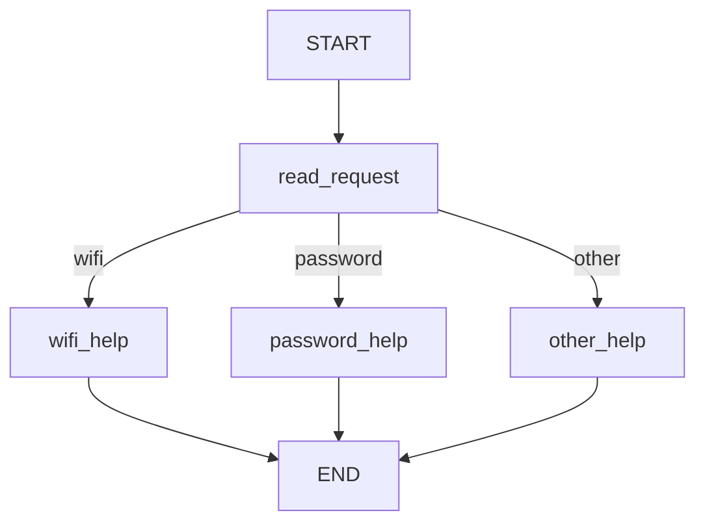
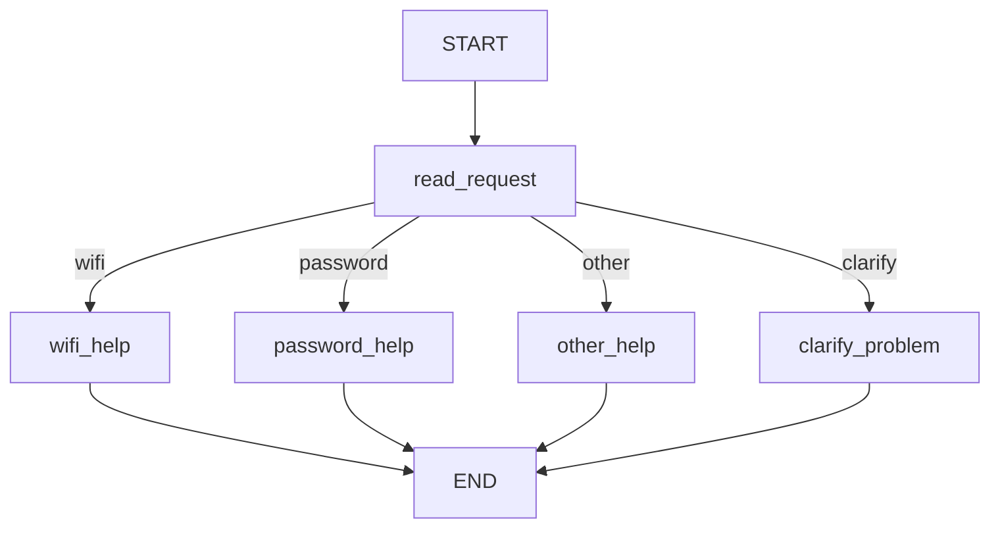
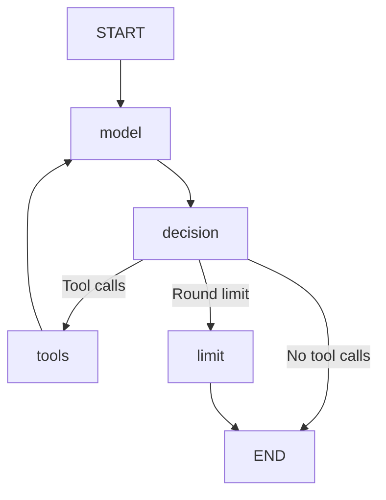

# HW5 — My LangGraph Helpdesk

## Part 1 — How the graph works

### My graph and state

I built a simple university IT helpdesk using LangGraph without an LLM. It identifies Wi-Fi and password problems and retrieves fictional instructions from `data/helpdesk.json`.

**Original graph:**



**State:** `message`, `category`, `reply`.

- `read_request` reads the message and updates the category.
- `wifi_help` retrieves Wi-Fi instructions and updates the reply.
- `password_help` retrieves password recovery instructions and updates the reply.
- `other_help` asks for clarification when the topic is unsupported.
- `choose_route` selects the next node based on the category.

A node performs an operation and updates shared state. A conditional edge selects the next node. State stores information shared between nodes. `START` and `END` define the graph boundaries, and `compile()` prepares the graph for execution.

### Predictions before running

| Message | Predicted route | Actual route | What I learned |
|---|---|---|---|
| I cannot connect to Wi-Fi. | wifi_help | wifi_help | Wi-Fi is recognized correctly. |
| I forgot my PASSWORD. | password_help | password_help | Classification is case-insensitive. |
| My laptop screen is broken. | other_help | other_help | Unsupported requests need clarification. |
| My Wi-Fi password does not work. | wifi_help | wifi_help | Wi-Fi has priority in the original graph. |

**Result:** All four original routing tests passed.

**Evidence:** `outputs/part1_original_trace.txt`

### My change to the graph

I modified the graph by adding a new node called `clarify_problem`.

The original graph automatically selected Wi-Fi when a message mentioned both Wi-Fi and password. The modified graph asks the user which problem they mean.

**Modified graph:**



**Actual modified trace:**

`START → read_request → clarify_problem → END`

**Result:** All four modified routing tests passed.

**Evidence:** `outputs/part1_modified_trace.txt`

### What I learned

LangGraph manages execution flow, state updates, and routing. My Python functions define how requests are classified and how responses are generated.

The modified graph is safer for ambiguous requests because it asks for clarification instead of making an automatic assumption.

---

## Part 2 — Model and tools

### Implementation

I implemented an LLM-driven university IT helpdesk agent using LangGraph and OpenRouter.

**Provider:** OpenRouter

**Model:** `deepseek/deepseek-chat`

**Main files:**
- `part2_agent.py`
- `part2_tools.py`
- `part2_s14.py`

The agent uses three tools to retrieve instructions, check service status, and prepare local support ticket drafts.

### My three tools

**1. find_instructions**

This tool retrieves troubleshooting instructions from `data/helpdesk.json`.

It supports Wi-Fi and password recovery topics.

The result includes the topic, instruction ID, title, and troubleshooting steps.

**2. check_service_status**

This tool reads fictional service information from `data/service_status.json`.

The available profiles are:

- `normal`
- `wifi_outage`
- `recovery_outage`
- `status_unavailable`

The tool returns the service status and a message explaining the result.

**3. prepare_ticket**

This tool creates a local ticket draft using `data/ticket_template.json`.

The draft includes the user ID, thread ID, issue category, summary, troubleshooting steps, service status, and reference IDs.

The ticket is not submitted to a real support system.

### Agent workflow

The LangGraph agent follows this workflow:



The model decides which tool to call. The tool executes a local Python function and returns a result.

The model can use the result to call another tool or provide a final response.

I added a maximum of five tool rounds to prevent an infinite loop.

### Safety rules

I implemented the following rules:

- The agent checks service status before preparing a conditional ticket.
- It does not prepare a ticket when an outage is reported.
- It does not prepare a conditional ticket when the status is unknown.
- The ticket tool requires a supported category, summary, and troubleshooting steps.
- Tickets remain local drafts.
- The assistant must not ask for passwords or recovery codes.
- The agent must not invent service status information.

The ticket tool also checks the verified service status before creating a draft. This provides protection beyond the system prompt.

### Direct tool tests

I tested the tools with local fictional data.

The tests included instruction retrieval, different service profiles, successful ticket creation, and missing ticket fields.

**Evidence:** `outputs/part2_direct_tools.txt`

### My actual scenario tests

| Scenario | Result | Evidence |
|---|---|---|
| S06 — Instructions and ticket | PASS — smoke test | `outputs/part2_s06.txt` |
| S07 — Wi-Fi outage | PASS — smoke test | `outputs/part2_s07.txt` |
| S08 — Status unavailable | PASS — smoke test | `outputs/part2_s08.txt` |
| S09 — Missing ticket details | PASS — smoke test | `outputs/part2_s09.txt` |
| S14 — Password recovery outage | PASS — direct tool and AI agent tests | `outputs/part2_s14.txt`, `outputs/part2_s14_agent.txt` |

In S06, the agent used troubleshooting information and checked the Wi-Fi service before preparing a local ticket draft.

In S07, the agent detected a Wi-Fi outage and did not prepare a conditional ticket.

In S08, the service status was unknown, so the agent did not prepare a ticket.

In S09, the agent first requested missing information. After the user provided the Wi-Fi issue and attempted steps, it checked the service and prepared a draft.

### S14 — Password recovery outage

I tested the password recovery outage scenario using `part2_s14.py`.

First, I tested `check_service_status` directly with the `recovery_outage` profile. The tool correctly returned `account_recovery` with the status `outage`.

Next, I tested the actual LLM-driven LangGraph agent using OpenRouter.

The agent independently called `status_tool` with the argument `{"service": "password"}`. The tool resolved this to `account_recovery` and returned the verified outage status.

The agent reported that the password recovery service was unavailable and did not invent a repair time.

**Actual validation results:**

- Status tool called: PASS
- Correct service checked: PASS
- No ticket tool called: PASS
- Outage explained: PASS
- No invented repair time: PASS

**Tool rounds:** 1

**Final result:** S14 AI AGENT TEST: PASS

**Evidence:**
- `outputs/part2_s14.txt`
- `outputs/part2_s14_agent.txt`

### Limitations

The model-driven scenario tests depend on an external LLM, so exact wording and tool decisions may vary between runs.

The automated pytest suite currently tests the local tools, not the complete LLM tool loop.

---

## Part 3 — Memory

### Implementation

I implemented persistent conversation memory using LangGraph and SQLite.

**Main files:**
- `part3_agent.py`
- `part3_memory.py`
- `part3_preferences.py`
- `check_memory.py`

### Conversation memory

I used `SqliteSaver` as a LangGraph checkpointer.

It stores conversation messages in a local SQLite database.

The agent can retrieve earlier messages from the same conversation, even after the Python process is restarted.

Conversation identifiers combine the user ID and thread ID:

`user_id::thread_id`

This separates conversation histories belonging to different users.

### User preferences

I implemented a separate SQLite table for user preferences.

Preferences are stored by `user_id`.

For example, when a user requests responses in Kazakh, the preference is saved and can be reused in a different conversation thread.

This allows the system to remember a language preference without copying the previous conversation history.

### Memory and reference data

I separated three types of information:

**Conversation memory:** Previous messages belonging to a specific conversation.

**User preferences:** Persistent information such as the user's preferred language.

**Reference data:** Fictional university helpdesk instructions and service information stored in JSON files.

The JSON reference data is not treated as a user's personal memory.

### My actual memory tests

| Scenario | Result | Evidence |
|---|---|---|
| S10 — Conversation memory | PASS — basic memory test | Console output |
| S11 — Restart persistence | PASS — basic restart test | `outputs/part3_s11.txt` |
| S12 — Preference across threads | PASS — integration smoke test | `outputs/part3_s12_agent.txt` |
| S13 — User isolation | PASS — integration smoke test | `outputs/part3_s13_agent.txt` |

### S10 — Conversation memory

The user reported that Wi-Fi was not working and mentioned two attempted steps:

1. Enabled Wi-Fi.
2. Tried reconnecting.

When asked what steps had already been tried, the agent recalled both correctly.

### S11 — Restart persistence

I saved a conversation in SQLite, closed the Python process, and started a new process.

The agent correctly recalled the earlier Wi-Fi problem and troubleshooting steps.

**Evidence:** `outputs/part3_s11.txt`

### S12 — Preference across threads

User A requested responses in Kazakh.

The preference was saved separately from the conversation history.

In a different thread, the agent correctly identified the saved language preference and responded in Kazakh.

**Evidence:** `outputs/part3_s12_agent.txt`

### S13 — User isolation

User A requested Kazakh responses and reported a Wi-Fi problem.

User B started a separate conversation and asked whether they had previously specified a language or reported a problem.

The agent did not reveal User A's language preference or Wi-Fi problem to User B.

**Evidence:** `outputs/part3_s13_agent.txt`

### Limitations

The S11 restart test verified conversation recall but did not include the complete language-preference requirement.

The S12 integration test used separate threads in one process. Preference persistence across process restart was verified separately using `part3_preferences.py`.

The Part 3 memory agent and Part 2 tool agent are currently implemented separately. A fully integrated persistent tool-using agent has not yet been tested.

---

## Part 4 — Running and checking my work

### Environment

I developed and tested the project using:

- Python 3.9.6
- Visual Studio Code
- macOS
- LangGraph
- LangChain OpenAI
- OpenRouter
- SQLite
- pytest

### Dependencies

I pinned the main dependencies in `requirements.txt`:

```text
langgraph==0.6.11
langchain-openai==0.3.35
langgraph-checkpoint-sqlite==2.0.11
python-dotenv==1.2.1
pytest==8.4.2
```

### Installation

Create a virtual environment:

```bash
python3 -m venv .venv
```

Activate it on macOS or Linux:

```bash
source .venv/bin/activate
```

Install dependencies:

```bash
python -m pip install -r requirements.txt
```

Create a local `.env` file using `.env.example` as a template.

Add a valid OpenRouter API key to `.env`.

The API key must not be committed to GitHub.

### Running the project

Run the original Part 1 graph:

```bash
python part1.py
```

Run the modified Part 1 graph:

```bash
python part1_modified.py
```

Run the Part 2 scenarios:

```bash
python part2_agent.py S06
python part2_agent.py S07
python part2_agent.py S08
python part2_agent.py S09
python part2_s14.py
```

Run the Part 3 integrated preference tests:

```bash
python part3_agent.py S12
python part3_agent.py S13
```

### Automated tests

I implemented nine pytest tests in:

`tests/test_helpdesk_tools.py`

These tests check:

- Wi-Fi instruction retrieval.
- Password instruction retrieval.
- Unsupported topics.
- Normal Wi-Fi service status.
- Wi-Fi outage.
- Unknown service status.
- Password recovery outage status.
- Successful ticket draft creation.
- Missing ticket fields.

**Command:**

```bash
python -m pytest tests/ -v
```

**Actual local result:**

`9 passed in 0.01s`

**Evidence:** `outputs/part4_pytest.txt`

The automated tests do not require an OpenRouter API key.

### GitHub Actions CI

I created a workflow at:

`.github/workflows/tests.yml`

The workflow:

1. Checks out the repository.
2. Sets up Python 3.9.
3. Installs dependencies.
4. Checks package compatibility.
5. Runs automated pytest tests.

I changed the runner to `ubuntu-22.04` after the first run could not find Python 3.9 on the default Ubuntu runner.

**Actual GitHub Actions result:** SUCCESS

**Successful run:** HW5 Automated Tests #2

**Commit:** `df099d7`

**Duration:** Approximately 30 seconds.

### Security

The `.gitignore` file excludes:

- `.env` and local environment files.
- `.venv/`
- Python cache files.
- SQLite database files.
- Local storage directories.

The repository includes `.env.example` with configuration placeholders instead of a real API key.

### Resetting local memory

The conversation checkpoints are stored in local SQLite files inside `outputs/`.

The user preferences are stored in a separate SQLite database.

To reset local memory, stop the application and remove the generated SQLite database files. The application can recreate them on the next run.

This deletes locally saved conversation history and preferences.

### Testing limitations

The nine automated tests verify local tool behavior.

They do not yet automatically verify the complete LangGraph agent, tool-call sequence, conversation persistence, or all supplied scenarios.

The project uses fictional local helpdesk data and does not connect to a real university IT support system.

---

## Choices and limitations

I chose LangGraph because it supports explicit graph execution, conditional routing, tool loops, and persistent checkpoints.

I used Python functions for deterministic operations and JSON files for fictional helpdesk reference data.

I used OpenRouter to connect the language model to the tool-driven agent.

I used SQLite because it provides lightweight persistent storage without requiring a separate database server.

I separated conversation history from user preferences to support user isolation and preference reuse.

The Part 1 classifier uses simple rules and may not recognize spelling mistakes such as `wifffi`.

The system cannot repair Wi-Fi or password services directly.

Support tickets are local drafts only and are never submitted to a real helpdesk.

The current implementation separates the tool-using agent from the persistent-memory agent.

---

## Supplied scenarios — my actual results

| Scenario | Command or manual steps | Log file | What happened / what I changed |
|---|---|---|---|
| S01 — Simple Wi-Fi route | `python part1.py` | `outputs/part1_original_trace.txt` | PASS — Wi-Fi route |
| S02 — Case-insensitive password route | `python part1.py` | `outputs/part1_original_trace.txt` | PASS — Password route |
| S03 — Unsupported request | `python part1.py` | `outputs/part1_original_trace.txt` | PASS — Other route |
| S04 — Two topics before the graph change | `python part1.py` | `outputs/part1_original_trace.txt` | PASS — Wi-Fi priority |
| S05 — Two topics after adding clarification | `python part1_modified.py` | `outputs/part1_modified_trace.txt` | PASS — Clarification |
| S06 — Instructions then local ticket | `python part2_agent.py S06` | `outputs/part2_s06.txt` | PASS — smoke test; normal Wi-Fi status and ticket draft |
| S07 — Wi-Fi outage | `python part2_agent.py S07` | `outputs/part2_s07.txt` | PASS — smoke test; outage reported without conditional ticket |
| S08 — Status unavailable | `python part2_agent.py S08` | `outputs/part2_s08.txt` | PASS — smoke test; unknown status and no ticket |
| S09 — Missing ticket details | `python part2_agent.py S09` | `outputs/part2_s09.txt` | PASS — smoke test; requested details before creating a draft |
| S10 — Conversation memory | `python part3_agent.py S10` (earlier version) | Console output | PASS — basic memory test |
| S11 — Restart persistence | `python part3_agent.py S11_SAVE` and `S11_LOAD` (earlier version) | `outputs/part3_s11.txt` | PASS — basic restart memory |
| S12 — Preference across threads | `python part3_agent.py S12` | `outputs/part3_s12_agent.txt` | PASS — integration smoke test |
| S13 — User isolation | `python part3_agent.py S13` | `outputs/part3_s13_agent.txt` | PASS — integration smoke test |
| S14 — Password recovery outage | `python part2_s14.py` | `outputs/part2_s14.txt`, `outputs/part2_s14_agent.txt` | PASS — direct tool and AI agent tests; outage reported, no ticket created |

---

## Final reflection

This assignment helped me understand how LangGraph manages state, routing, tools, and persistent memory.

In Part 1, I learned how deterministic graph routing works.

In Part 2, I learned how a language model can select tools and use their results to answer users.

In Part 3, I learned how SQLite checkpoints preserve conversations and how user preferences can be stored separately.

In Part 4, I learned how to test Python functions with pytest and automatically run tests using GitHub Actions.

The most important lesson was that an AI assistant needs more than a language model. It also needs controlled execution, reliable data, safety checks, testing, and memory isolation.

The project is a working educational prototype, with some integration and scenario coverage still remaining.
