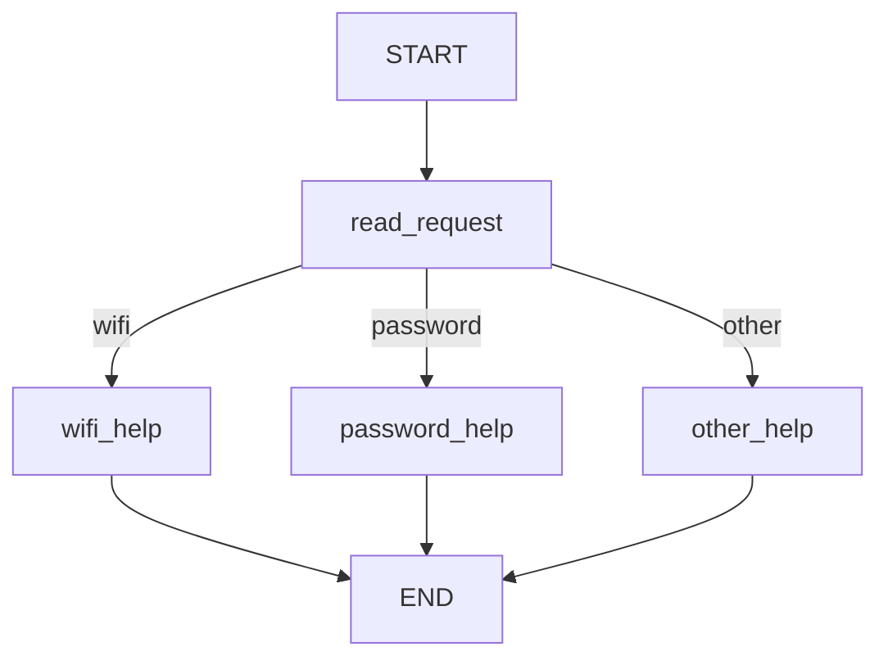
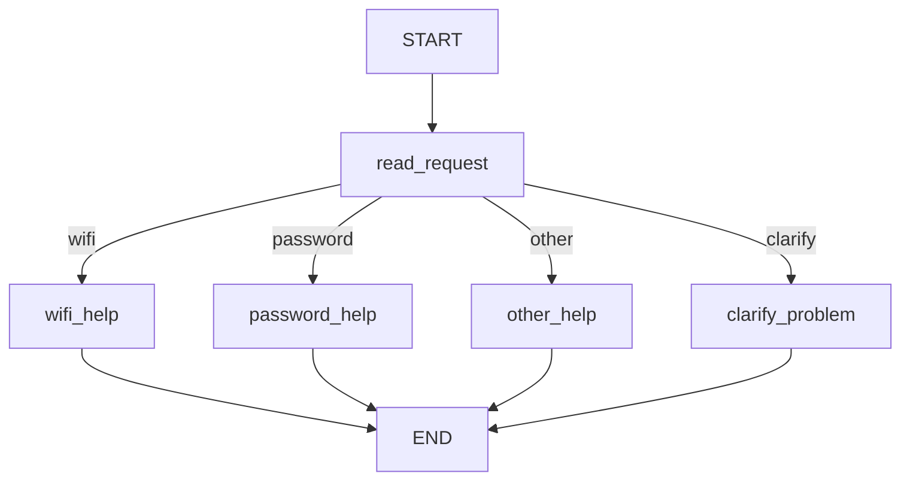

# HW5 — My LangGraph Helpdesk

## Part 1 — How the graph works

### My graph and state

I built a simple IT helpdesk using LangGraph without an LLM. It identifies Wi-Fi and password problems and reads instructions from `data/helpdesk.json`.

**Original graph:**

**State:** `message`, `category`, `reply`.

- `read_request` reads `message` and updates `category`.
- `wifi_help` and `password_help` read JSON instructions and update `reply`.
- `other_help` updates `reply` with a clarification question.
- `choose_route` reads `category` and selects the next node.

A node updates state, while a conditional edge chooses the next node. State stores shared information. `START` and `END` define the workflow boundaries. `compile()` prepares the graph for execution.

### Predictions before running

| Message | Predicted route | Actual route | What I learned |
|---|---|---|---|
| I cannot connect to Wi-Fi. | wifi_help | wifi_help | Wi-Fi is recognized. |
| I forgot my PASSWORD. | password_help | password_help | Classification is case-insensitive. |
| My laptop screen is broken. | other_help | other_help | Unknown topics need clarification. |
| My Wi-Fi password does not work. | wifi_help | wifi_help | Wi-Fi has priority in the original graph. |

All four tests passed.

Log: `outputs/part1_original_trace.txt`

### My change to the graph

I added `clarify_problem` for messages containing both Wi-Fi and password topics.

**Actual new trace:**

`START → read_request → clarify_problem → END`

The new graph asks which problem the student means instead of automatically selecting Wi-Fi.

LangGraph controls execution, routing, and state updates. My Python functions define the classification rules and responses.

All four modified tests passed.

Log: `outputs/part1_modified_trace.txt`

## Part 2 — Model and tools

Not implemented yet.

Planned tools: `find_instructions`, `check_service_status`, and `prepare_ticket`. The ticket will be a local draft only.

Model/provider, tool loop, direct tool tests, loop limit, and actual logs will be added after implementation.

## Part 3 — Memory

Not implemented yet.

Conversation memory will use `thread_id`. User preferences will be stored separately by user ID. Helpdesk instructions will be retrieved from JSON, not treated as memory.

| Situation | Command used | Log file | What happened |
|---|---|---|---|
| Refer to an earlier message | Pending | — | Not tested |
| Close, restart and resume | Pending | — | Not tested |
| Same user, new conversation | Pending | — | Not tested |
| Different user | Pending | — | Not tested |

## Part 4 — Running and checking my work

Not completed yet.

README setup instructions, pinned dependencies, persistent memory reset, automated tests, and GitHub Actions will be documented after implementation.

## Choices and limitations

I used LangGraph for workflow control, Python for routing, and JSON for local instructions.

Part 1 does not use AI or persistent memory. It may not recognize spelling mistakes such as `wifffi`. It provides guidance but cannot directly repair a service.

## Supplied scenarios — my actual results

| Scenario | Command or manual steps | Log file | What happened / what I changed |
|---|---|---|---|
| S01 — Simple Wi-Fi route | `python part1.py` | `outputs/part1_original_trace.txt` | PASS — Wi-Fi route |
| S02 — Case-insensitive password route | `python part1.py` | `outputs/part1_original_trace.txt` | PASS — Password route |
| S03 — Unsupported request | `python part1.py` | `outputs/part1_original_trace.txt` | PASS — Other route |
| S04 — Two topics before the graph change | `python part1.py` | `outputs/part1_original_trace.txt` | PASS — Wi-Fi priority |
| S05 — Two topics after adding clarification | `python part1_modified.py` | `outputs/part1_modified_trace.txt` | PASS — Clarification |
| S06 — Instructions then local ticket | Pending | — | Not tested |
| S07 — The same request during a Wi-Fi outage | Pending | — | Not tested |
| S08 — Status source unavailable | Pending | — | Not tested |
| S09 — Missing ticket details | Pending | — | Not tested |
| S10 — Use the current conversation | Pending | — | Not tested |
| S11 — Persist and recall after restart | Pending | — | Not tested |
| S12 — Preference across threads without replay | Pending | — | Not tested |
| S13 — Do not share memory between users | Pending | — | Not tested |
| S14 — Password recovery outage | Pending | — | Not tested |
